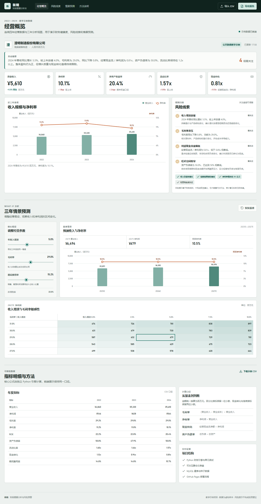
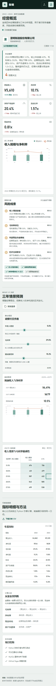

# 衡镜：财报健康分析与风险预警

衡镜是一个可直接打开的个人数据分析项目。它把连续财年数据整理为经营指标、风险线索、三年情景预测和敏感性分析，适合作为 Vibe Coding、Python 数据处理和基础财务分析的简历作品。

## 立即体验

双击根目录的 `index.html` 即可使用。项目内置虚构教学数据和完整交互，不要求安装环境、登录或输入 API Key。

在线体验无需安装环境、登录或输入 API Key：

- 在线 Demo：https://kayy-1.github.io/finscope-financial-health-dashboard/
- 源代码：https://github.com/kayy-1/finscope-financial-health-dashboard
- 演示视频：待录制

## 页面预览






可打印版本：[PDF 示例报告](screenshots/demo-report.pdf)

## 核心能力

- 展示营业收入、净利率、ROE、流动比率和现金转化等经营指标。
- 根据统一阈值识别收入放缓、毛利承压、利润现金含量下降和杠杆空间收窄。
- 提供收入增速、毛利率与期间费用率的情景预测。
- 输出收入增速与毛利率的三年敏感性矩阵。
- 支持导入同口径 CSV，并即时重新计算分析结果。
- 支持浏览器打印或导出 PDF 报告。

## 项目结构

```text
个人项目/
├─ index.html                     # 可直接打开的仪表盘
├─ styles.css                     # 响应式界面样式
├─ app.js                         # 交互、图表与前端计算
├─ finance_engine.py              # Python 财务计算引擎
├─ data/
│  ├─ sample_financials.csv       # 示例数据与导入模板
│  └─ demo-data.js                # Python 生成的浏览器数据
├─ db/
│  ├─ mysql_schema.sql            # MySQL 8.0 表结构
│  └─ seed.sql                    # 示例种子数据
├─ scripts/
│  ├─ generate_demo_data.py        # 重新生成前端数据
│  └─ visual_check.cjs             # 浏览器交互与截图检查
├─ tests/
│  └─ test_finance_engine.py      # 财务公式与预测测试
├─ docs/
│  ├─ formulas.md                 # 公式和阈值说明
│  ├─ acceptance.md               # 交付验收记录
│  ├─ prompt-log.md               # AI 协作过程记录
│  └─ demo-script.md              # 90 秒演示脚本
└─ screenshots/                   # 桌面、移动端与公网截图
```

## 本地验证

本项目的前端无运行时依赖。财务引擎只使用 Python 标准库。

```powershell
python scripts/generate_demo_data.py
python -m unittest discover -s tests -v
```

如果系统没有 Python，前端仍可直接打开；重新生成数据和运行测试需要 Python 3.10 或更高版本。

浏览器级检查为可选步骤，需要 Node.js 和 Playwright：

```powershell
npm install
npx playwright install chromium
npm run check:visual
```

检查脚本会验证桌面和移动端布局、风险卡片数量、交互联动和 CSV 导入，并重新生成截图与 PDF 报告。

## CSV 字段

导入文件需要包含以下表头，金额统一使用人民币百万元：

```text
year,revenue,cogs,operating_expenses,net_income,current_assets,
current_liabilities,total_liabilities,total_assets,equity,
operating_cash_flow,accounts_receivable,inventory
```

示例文件位于 `data/sample_financials.csv`。

## MySQL

在 MySQL 8.0 环境中依次执行：

```sql
SOURCE db/mysql_schema.sql;
SOURCE db/seed.sql;
SELECT * FROM company_financial_summary ORDER BY fiscal_year;
```

导入型仪表盘本身采用纯前端运行，因此没有假称已接入远程数据库。MySQL 脚本用于展示表设计、约束、索引关系和财务汇总视图。

## GitHub Pages 部署

1. 在仓库 `Settings > Pages` 中将 Source 设为 `Deploy from a branch`。
2. 选择 `main` 分支和 `/ (root)` 目录。
3. 保存后等待 GitHub Pages 完成构建。
4. 当前发布地址为 `https://kayy-1.github.io/finscope-financial-health-dashboard/`。

## 数据与限制

- 示例公司、名称和数据均为虚构教学样本，不代表任何真实企业。
- 风险规则是项目内定义的可解释观察线，不是信用评级或投资建议。
- 情景预测采用简化利润表逻辑，不包含营运资本、资本开支、融资现金流和会计政策调整。
- 真实分析应结合行业特征、审计意见、财报附注和管理层讨论。

## 开发说明

项目采用 Vibe Coding 思路完成，生产过程在 `docs/prompt-log.md` 中记录了需求拆解、公式校验、部署约束和迭代修正。资金计算、财务公式和可交互预测均由代码完成，AI 只参与需求转译、实现和检查。
